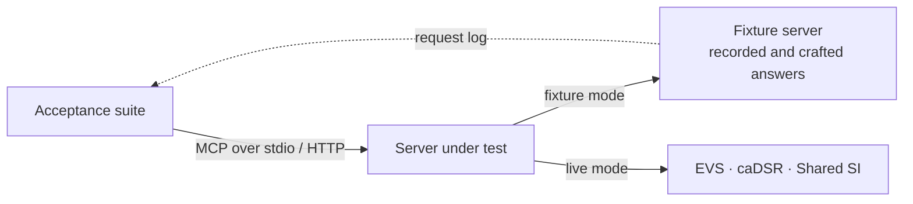

# NCI SI MCP

[](https://github.com/CBIIT/nci-sip-mcp/actions/workflows/ci.yml?query=branch%3Amain)
[](https://github.com/CBIIT/nci-sip-mcp/actions/workflows/github-code-scanning/codeql?query=branch%3Amain)
[](https://scorecard.dev/viewer/?uri=github.com/CBIIT/nci-sip-mcp)
[](https://github.com/CBIIT/nci-sip-mcp/blob/coverage-badges/provenance.json)
[](https://github.com/CBIIT/nci-sip-mcp/blob/coverage-badges/provenance.json)
[](LICENSE)
[](pyproject.toml)

CI and CodeQL badges track `main`. Coverage badges show combined line and branch coverage
from successful main CI, with the measured commit and run linked; they are not acceptance pass rates.
Scorecard measures repository security practices, not acceptance outcomes.
[SCORECARD.md](SCORECARD.md) explains the score and what keeps it below 10.

The NCI Semantic Infrastructure Model Context Protocol (MCP) server, built to production standards
and likely to become the production codebase, though not yet declared production. It serves
terminology (NCI Thesaurus through EVS) and metadata (common data elements through caDSR), with
the cross-domain tools that join them, and it never returns content it did not retrieve:
[what the server must do](docs/specification.md#what-the-server-must-do).

> **Current upstream access limits:** Green fixtures do not establish live production access.
> Production caDSR requests are prohibited, Shared SI/SSIS traffic is paused, protected caDSR
> credentials have not been issued, and Acceptance(live) is disabled. Read the
> [dated access and transition guidance](QUICKSTART.md#upstream-access-and-ssis-transition) before setup.

The repository holds four deliverables:

- **The MCP server** with its local NCIt index: [QUICKSTART.md](QUICKSTART.md).
- **The acceptance suite** that it and its successors are measured by:
  [acceptance/README.md](acceptance/README.md).
- **The documentation site**, these documents as a searchable website:
  [docs/documentation-site.md](docs/documentation-site.md).
- **The admin interface**, the validation dashboard for acceptance and benchmark runs:
  [docs/local-validation.md](docs/local-validation.md).

## Try it

**Breaking caDSR metadata change:** omitted scalar fields now stay absent instead of becoming
null; explicit null stays null. Item-owned dates and optional component identities support
[version-aware citations](QUICKSTART.md#provenance-and-truncation), with ordered API concept derivations.
Included object-class/property derivations with missing or non-Yes/No primary flags now return
`upstream_unavailable`; malformed supplied `displayOrder` is rejected instead of passed through.

Install a released server with the [local guide prerequisites and server sequence](docs/local-guide.md#prerequisites). From a checkout:

```bash
pdm install                  # Python 3.14+ and PDM; see the prerequisites below
pdm run nci-si-mcp serve     # the server, over MCP stdio
pdm run acceptance           # the acceptance suite against it, on recorded upstream answers
```

[Platforms and prerequisites](QUICKSTART.md#platforms-and-prerequisites) lists what to install first.
Python 3.14 is the validated development, CI and release baseline; older interpreters are
outside the supported configuration. [GitHub Releases](https://github.com/CBIIT/nci-sip-mcp/releases)
are the changelog.
A plain `pdm run acceptance` skips prepared, secured and optional registry-release checks.
The [complete fixture command](CONTRIBUTING.md#complete-fixture-ratchet) supplies preparation, the security
adapter and `NCI_SI_ACCEPTANCE_REGISTRY_RELEASE=required` to run all cases.

[QUICKSTART.md](QUICKSTART.md) has the rest: connecting a client, settings, tools and errors.
Protected live workflow checks need issued [workflow credentials](CONTRIBUTING.md#workflow-credentials);
fixture CI and anonymous live checks do not.

The client model holds the conversation and selects tool calls; the prompts guide it.
The tools are deterministic; the server runs no LLM.
Workflow tools also bundle their own upstream calls deterministically, with provenance.
[Domain-user stories and UAT plan](docs/user-acceptance.md) describe four proposed journeys.
UAT runs in any MCP-capable client that uses an NCI-approved model provider; none has run yet.

## How the pieces fit



The suite tests the MCP tool surface of a server it starts or connects to, against fixtures or
the live services; it knows nothing of the server's code.

[Architecture diagrams](ARCHITECTURE.md) cover system context, components, request flow,
index lifecycle and data. [Deployment diagrams](docs/deployment.md) show local stdio, local
containers and the proposed Cloud One layout.

[Behavioural test stories](docs/behavioural-tests.md) document every MCP acceptance case,
grouped by user goal, with expected answers, failure cases and links to executable evidence.

## Status

The specification names 29 tools in four groups. [Functional status](docs/functional-status.md)
explains what was tested, against which service and environment, with dated results, limitations
and evidence. Passing fixtures do not establish current live access or successful retrieval
for an operation whose correct result is refusal.

Production caDSR access remains prohibited, SSIS traffic paused, protected credentials unissued
and automated Acceptance(live) disabled. Cross-domain joins depend on Shared SI; replacement
gaps remain unresolved. Read the [access guidance](QUICKSTART.md#upstream-access-and-ssis-transition)
and functional-status checkpoints before any separately authorized diagnostic.

The [milestones](https://github.com/CBIIT/nci-sip-mcp/milestones) track open work;
[deployment guidance](docs/deployment.md) describes the trusted-local default and disabled
UAT/PROD administration. UAT has not run.

## Start here

- **The EVS, caDSR and Shared SI teams**: [docs/specification.md](docs/specification.md) specifies the
  required tools and their behaviour (rendered from `spec/`); [docs/implementation-plan.md](docs/implementation-plan.md) records
  the work, phase by phase;
  [acceptance/README.md](acceptance/README.md) runs the suite against your server and renders the
  per-tool report; the upstream requests the tools rest on, each with its operation and
  rationale, are listed for [EVS](acceptance/request-forms/evs.md), for
  [caDSR](acceptance/request-forms/cadsr.md), for the
  [Shared SI Service](acceptance/request-forms/ssis.md) and for [all](acceptance/request-forms/all.md).
  [Upstream requirements](docs/upstream/README.md) link the remaining platform requests to
  their evidence, affected tests, workarounds and acceptance criteria.
- **NCI reviewers and the suite's maintainers**: [acceptance/README.md](acceptance/README.md) and
  [acceptance/fixtures/README.md](acceptance/fixtures/README.md), where the fixtures come from.
- **Building or maintaining an NCIt index**: the [semantic index guide](docs/ncit-semantic-index.md)
  explains its fields, model, evidence and build/evaluate/activate/rollback procedure.
- **Working on this repository**: [CONTRIBUTING.md](CONTRIBUTING.md) for the commands, standards
  and gates; [ARCHITECTURE.md](ARCHITECTURE.md) for how the server is built.
  Everyone taking part follows the [code of conduct](CODE_OF_CONDUCT.md).

## License

[Apache License 2.0](LICENSE). The recorded NCI Thesaurus content in the fixtures is under its own
terms, stated in [acceptance/fixtures/README.md](acceptance/fixtures/README.md).
