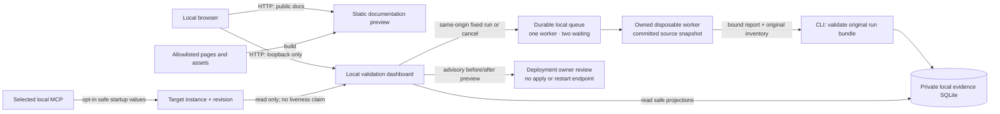
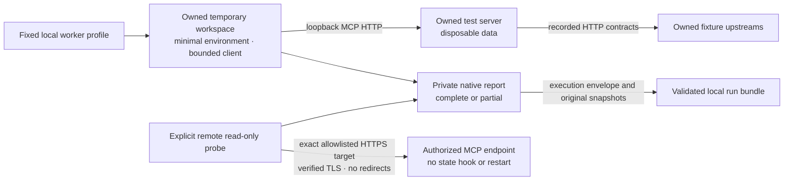
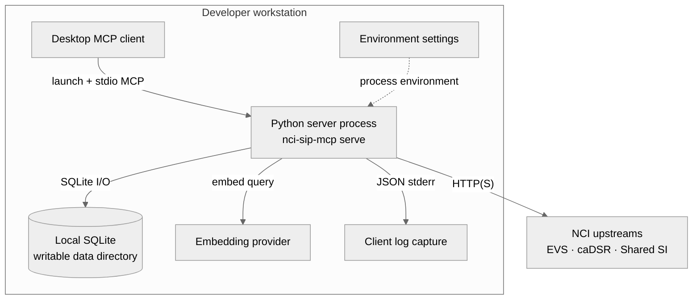
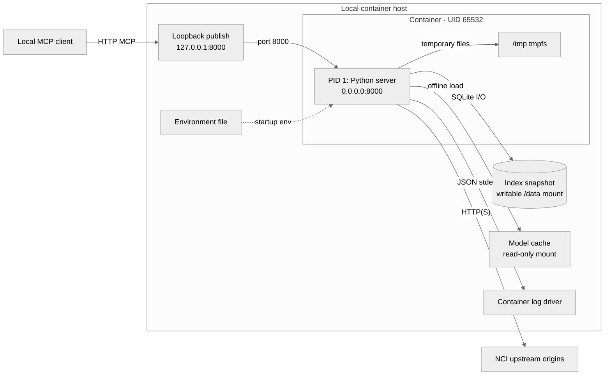
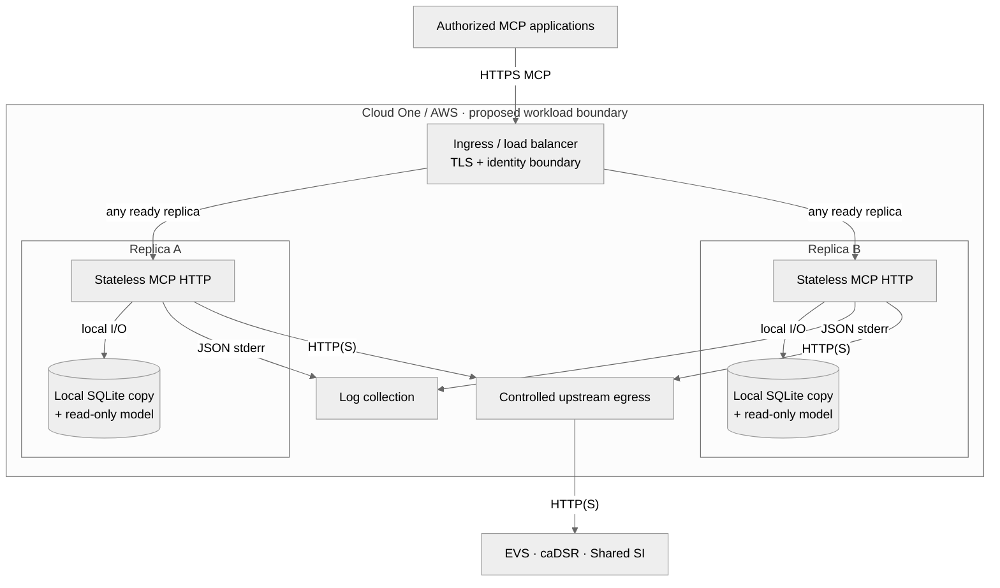

# Deployment views

These diagrams complement the [architecture views](../ARCHITECTURE.md) and the executable
[container runbook](container.md). Local views describe the supported local setup. The Cloud One
view is a **proposed reference layout**, not deployed infrastructure or an approved AWS design.
Solid arrows show calls, reads or output; dashed arrows show operator-supplied configuration
and assets. Labels identify protocols and storage permissions.

## Local documentation and validation companion

Public documentation and local validation use separate listeners and directories. The
[documentation builder](documentation-site.md) publishes only reviewed pages and assets;
the [validation dashboard](local-validation.md) reads locally imported evidence. Both are
accessible without login locally. The dashboard provides bounded run/cancel controls and
configuration proposals from an explicitly selected safe startup snapshot. It never reads the serving
MCP index or fetches upstream data while rendering results.
The [container composition](companion-containers.md) implements the same separation with
read-only images, an internal fixture network and a fixed-destination loopback admin relay.

Text alternative: a browser reads documentation from a static preview and validation results
from a separate loopback dashboard. A CLI validates original evidence before storing it locally;
only safe projections reach dashboard pages. Fixed run controls use a durable queue and disposable
workers; source snapshots and original inventory accompany measured results. The documentation
build has no path to this store. A selected MCP may write a safe startup snapshot for the
dashboard; revision-bound proposals never change that process or the deployment environment.
UAT/PROD administration remains disabled pending platform integration in #197; the public
documentation site remains anonymous. See the [government website assurance plan](government-site-assurance.md)
for accessibility and deployment-specific requirements still to verify.

### Disposable validation profiles

Text alternative: the local worker owns temporary data, the test server and fixture upstreams,
then reaps them. Remote probes are separate and never restart or prepare the remote service.
Both produce native reports with honest partial states. The local execution wrapper binds
these reports to run identity and original snapshots for import. Local process isolation does
not block OS network egress. The container composition places fixture workers on an internal
network with no published fixture ports, production mounts, inherited secrets or Docker socket.
See [HTTP benchmark bounds](benchmark.md#bounded-http-measurements).

## Local stdio

The MCP client launches and owns one server process. No listening HTTP port is required. A
stdio stream can retain its first implicit NCIt release; a one-shot CLI command resolves per
call. A local index is optional for live content tools but required for semantic/hybrid search.

The index is built and evaluated through separate [CLI commands](../QUICKSTART.md#build-a-small-local-index).
Fixture mode redirects upstream requests to the local fixture server; it does not manufacture
successful live caDSR responses. See [client configuration](../QUICKSTART.md#connect-a-client).

## Local container over HTTP

This is the runbook's loopback-only Docker deployment. The image defaults to stateless HTTP
and a required index. It loads an externally supplied model offline, and never builds or
activates an index while serving. The root filesystem is read-only; `/data` and `/tmp` are
writable, and `/model-cache` is mounted read-only. Plain local Python HTTP also works with
`serve --transport streamable-http`; unlike the image, it defaults to stateful sessions and
does not require an index for readiness.

Host/Origin admission applies even on loopback and to health probes. `/health` checks the
process; `/ready` checks local index/model compatibility, not upstream availability. The
`/health` and `/ready` probes are unauthenticated and must be reachable only from the
orchestrator network. The
default image has no client authentication configured. Keep it private until the approved
identity integration is supplied. Allow 20 seconds for SIGTERM shutdown; commands and mount
requirements are in the [runbook](container.md#start-with-external-assets).

## Cloud One reference layout

The intended hosting environment is NCI CBIIT Cloud One (AWS). The hosting team still chooses
compute/orchestration, network topology, TLS termination, identity integration, secret and
artifact services, and deployment roles. The boxes below specify responsibilities without
selecting ECS, EKS, an AWS identity provider, or a shared filesystem. No such infrastructure
is provisioned by this repository.

The project requires Cloud One's FISMA Moderate admission checks before deployment to UAT
or PROD. Repository tests, scans and review evidence support those checks; a green CI run
does not certify compliance or authorize deployment. The hosting/security team determines
the applicable controls and required evidence for the deployed configuration, including
platform identity, permissions, network boundaries, secrets, logging and incident response.

Operational constraints apply whichever AWS services implement these boxes:

- **Stage each replica before readiness.** Deploy a verified GHCR image digest, copy the
  prepared index and matching model, and inject settings and secrets through the environment.
  Each process exposes `/mcp`, `/health` and `/ready`; image evidence is attached to its release.
- **Require approved authentication.** Set `NCI_SIP_HTTP_AUTH_MODE=required` and install the
  [governed HTTP integration](governed-http.md); absent integration fails before listening.
  The local default remains trusted-local. Configure actual Host/Origin authorities;
  forwarded identity headers never grant access. Production identity is still deferred/off.
- **Stateless replicas are independent.** An omitted NCIt release resolves per call. Name a
  release explicitly when calls must agree across replicas or time. For stateful handshake
  clients, route each session to its owning process; a different replica returns 404.
  [The routing sequence](transport.md#session-routing-sequence) shows that failure and recovery.
- **Serving storage is local to each replica.** Distribute a consistent SQLite backup,
  including the active build and retained predecessor; never share a live writable database
  across replicas over a network filesystem. Preserve the model identity used by the index.
  Build/evaluate/activate in an operator workspace, then roll out matching snapshots and models.
  Rollback activates the predecessor in that workspace and redistributes it. The server does
  not synchronize assets or sessions; an asset rollout can invalidate build-bound cursors.
- **Migrate an older index before serving.** A file with an older schema migrates on first
  open, in one write transaction, before the process serves. Do that in the operator workspace
  while no server holds the file (any operator command, for example `index-builds`, opens it),
  then distribute the migrated file. The `nci_sip_mcp.index` log records
  `index_migration_started` and, after the commit, `index_migration_finished` with
  `from_version`, `to_version` and `elapsed_seconds`. A start without a finish means the
  migration rolled back or the process stopped; the file is still at `from_version`. A new empty
  file is created without either record.
- **Directory models are identified by a hash.** A model supplied as a directory (such as the
  container's `/model`) is hashed over its files when the process starts; an index records the
  hash it was embedded with, and a different directory refuses start-up and readiness with an
  `index_model_revision_mismatch` record. Copy the model directory unchanged to each replica.
  An index built before this check stores no revision: rebuild, evaluate and activate it to
  record one. A Hub model served from the local cache is checked by its commit (see the
  [semantic index notes](ncit-semantic-index.md)).
- **Readiness gates local compatibility.** Probe each replica with an allowed Host header.
  Neither health endpoint guarantees live upstream service, issued caDSR credentials, or
  production retrieval quality. The container smoke uses a test-only model.
- **Publication and deployment remain separate.** The repository publishes verified public
  GHCR images. Cloud One ECR publication, AWS credentials/roles and infrastructure automation
  remain hosting work; this view does not implement or authorize them.
